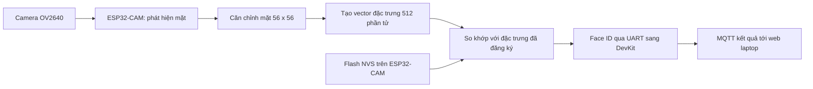

# Firmware và nối phần cứng — hướng dẫn từng bước

## Trước hết: yêu cầu “AI xử lý tại biên / vi xử lý”

Theo yêu cầu bạn vừa làm rõ, thầy không chỉ định Edge Impulse hoặc bắt buộc tự huấn luyện mô hình. Chúng ta chọn **chạy nhận diện ngay trên ESP32-CAM**; cách này phù hợp yêu cầu xử lý tại biên về nguyên tắc.

ESP32-CAM đã có vi điều khiển ESP32. Firmware dùng mô hình có sẵn của Espressif; **Enroll** là đăng ký đặc trưng để nhận lại từng người, khác với tự huấn luyện lại mô hình. Laptop chỉ lưu dữ liệu và hiển thị kết quả.

Không cần tắt Wi-Fi trong vận hành để được gọi là Edge AI. Việc nhận diện khi không có mạng là một cách demo giúp thấy rõ nơi chạy AI.

### Mô hình nào, nạp vào đâu và đăng ký có phải huấn luyện không?

Firmware dùng **esp-face đời cũ trong Arduino-ESP32 Core 2.0.0**: MTMN phát hiện khuôn mặt; nhánh nhận diện MobileFace/FRMN của Espressif tạo đặc trưng để so khớp danh tính. Đây là mô hình đã được huấn luyện sẵn. Tài liệu [ESP-WHO đời tương ứng](https://github.com/espressif/esp-who/blob/v0.9.0/README.md) mô tả MTMN / MobileFace; [API Core 2.0.0](https://github.com/espressif/arduino-esp32/blob/2.0.0/tools/sdk/esp32/include/esp-face/face_recognition/include/fr_forward.h) quy định ảnh căn chỉnh 56×56 và vector 512 phần tử.

Bạn không cần tải thêm file model qua Wi-Fi hoặc tự huấn luyện bằng Edge Impulse. Khi **Verify**, Arduino liên kết thư viện và trọng số mô hình vào chương trình; khi **Upload vào ESP32-CAM**, firmware cùng mô hình được ghi vào flash của board camera. ESP32-CAM đã có chip ESP32 riêng; ESP32-DevKit là board thứ hai, không chạy mô hình trong kiến trúc này.

Khi đăng ký, ESP32-CAM chạy mô hình cho từng ảnh đã căn chỉnh và thu **5 vector nhất quán của cùng một người**. Camera lấy trung bình, chuẩn hóa L2 và kiểm tra trùng với các hồ sơ đã lưu trước khi cấp Face ID. Mỗi người có một vector tham chiếu 512 phần tử. Trọng số mô hình giữ cố định khi thêm sinh viên.

Khi điểm danh, ESP32-CAM so vector vừa trích xuất với các hồ sơ bằng độ tương đồng cosine và lấy Face ID có điểm cao nhất vượt ngưỡng `0.55` của thư viện. Các vector đã đăng ký trên firmware cũ được chuẩn hóa lại trong RAM mỗi lần khởi động.



| Dữ liệu | Nơi lưu / xử lý |
|---|---|
| Firmware và mô hình có sẵn | Flash của ESP32-CAM, nạp qua Arduino IDE |
| Ảnh vừa chụp / ảnh căn chỉnh | Bộ nhớ tạm của ESP32-CAM; không lưu ảnh gốc vào NVS |
| Đặc trưng khuôn mặt đã đăng ký, Face ID và mã lượt đăng ký | NVS namespace `classroom-face` trong flash ESP32-CAM; khôi phục vào RAM khi khởi động |
| MSSV, họ tên, ánh xạ Camera / Face ID, buổi học và kết quả điểm danh | SQLite `backend/instance/classroom.sqlite3` trên laptop |
| Ảnh xem trước trên web quản lý | Chuyển tạm từ camera qua Flask tới trình duyệt; không lưu file ảnh, không suy luận AI trên laptop |
| Kết quả đang chờ gửi / mở cửa | RAM và logic của DevKit; không giữ mô hình nhận diện |

Khi mất điện, dữ liệu đã lưu hoàn tất trong NVS và SQLite vẫn được giữ; ảnh / mẫu đang thu dở trong RAM thì không. Firmware giới hạn 7 người (Face ID 0–6). Khi trình bày, phân biệt **đăng ký đặc trưng** với **huấn luyện mô hình**.

### Thứ tự triển khai trên mạch thật

1. **Camera và web.** Bật Mobile Hotspot 2,4 GHz trên laptop. Cấp nguồn riêng cho ESP32-CAM. Lấy IP từ dòng `CAMERA URL`, nhập vào **Camera điểm danh** trên web laptop, rồi thử ghi điểm danh bằng nút web và nút trên camera.
2. **DevKit và UART.** Nạp sketch DevKit, nối ba dây UART ở mục 3 rồi thử nút DevKit. Đọc `CAMERA UART: connected` và `CAMERA: recognized Face ID=…` trên Serial Monitor trước khi gắn servo vào cơ cấu cửa.
3. **Servo, đèn và cảm biến.** Ghép lần lượt servo, BH1750 với LED rồi MQ-2. Kiểm tra nguồn và hành vi từng phần theo mục 3. Nút trên DevKit mở servo khi nhận diện thành công. Nút web và nút trên ESP32-CAM ghi điểm danh. Web có lệnh mở cửa riêng.
4. **Giám sát và điều khiển trên web.** Khi các phần trên đã chạy, bật MQTT theo mục 5 để xem lux, ADC, độ sáng LED, cảnh báo gas và gửi lệnh mở/đóng cửa từ chính trang điểm danh. DevKit dùng cùng Mobile Hotspot nếu broker bên ngoài cần Internet.

Các khả năng mới của firmware đã biên dịch nhưng cần thử trên mạch thật trước khi khẳng định hoạt động.

Giữ nguyên dự án CameraWebServer-YAF cũ trong Downloads để có thể quay lại. Các file mới nằm trong `IOT/firmware/`; chưa có firmware nào được nạp tự động trong lần tạo dự án này.

## 1. ESP32-CAM

### Bước 1. Kiểm tra camera riêng

Chuẩn bị ESP32-CAM AI-Thinker, đế ESP32-CAM-MB và cáp USB có truyền dữ liệu. Ở mốc đầu, chưa cần nối DevKit, cảm biến hoặc servo vào camera.

Giữ thư mục YAF cũ để có thể nạp lại nếu cần.

### Bước 2. Mở đúng chương trình

Trong Arduino IDE, chọn **File → Open** rồi mở:

```text
F:\Downloads\IOT\firmware\esp32_cam\SmartClassroomCam\SmartClassroomCam.ino
```

Giữ nguyên cả thư mục `SmartClassroomCam`. Arduino tự biên dịch các file `.cpp` cùng thư mục.

Bản hiện tại kết nối vào **Mobile Hotspot của laptop**, đúng cách dùng trước đây. Ảnh đến từ camera gắn trên ESP32-CAM; laptop mở trình duyệt để xem ảnh và đăng ký. UART phục vụ nút điểm danh vật lý.

Trên Windows, vào **Settings → Network & internet → Mobile hotspot**, bật hotspot, xem **Network name / Network password** và đặt **Network band = 2.4 GHz** nếu có lựa chọn. Đây là mật khẩu hotspot, không phải mật khẩu đăng nhập Windows. Xem [hướng dẫn Microsoft](https://support.microsoft.com/en-us/windows/experience/connectivity-networking/use-your-windows-device-as-a-mobile-hotspot).

Điền `CAM_WIFI_SSID` và `CAM_WIFI_PASSWORD` trong `backend/.env`. Mở web bằng `start.bat` như thường lệ rồi Upload trong Arduino IDE. Khi khởi động, backend tự tạo cấu hình Wi-Fi cho Arduino. Git bỏ qua `.env` và file cấu hình được tạo. Khi đổi Wi-Fi, sửa `.env`, mở lại web rồi Upload.

### Bước 3. Chọn Core, board và cổng COM

1. Mở **Boards Manager**, tìm **esp32 by Espressif Systems**, kiểm tra phiên bản **2.0.0**. Bạn đã cài ở lần trước; nếu vẫn đúng thì giữ nguyên.
2. Cắm camera vào đế MB và nối USB với laptop như lần nạp trước.
3. Vào **Tools → Board → esp32 → AI Thinker ESP32-CAM**.
4. Vào **Tools → Port**, chọn cổng của camera.
5. Nếu chưa biết cổng nào: xem danh sách, rút USB camera, xem cổng biến mất; cắm lại và chọn cổng xuất hiện trở lại.

Không mặc định dùng COM4 từ cuộc trò chuyện cũ. Windows có thể thay đổi số cổng.

| Thiết lập | Giá trị |
|---|---|
| Board package | esp32 by Espressif Systems **2.0.0** |
| Board | AI Thinker ESP32-CAM |
| Partition Scheme, nếu có mục này | Huge APP 3 MB / No OTA |
| Upload / Serial | 115200 |
| Erase All Flash Before Sketch Upload, nếu có | Disabled |
| Camera | QVGA 320×240, JPEG quality 12, một framebuffer |

Không nâng Core của camera lên 3.x; firmware sử dụng API esp-face đời cũ đã có trong Core 2.0.0.

Nếu board AI Thinker không hiện mục Partition Scheme, giữ cấu hình mặc định. Lần biên dịch kiểm tra board này đã có vùng ứng dụng 3 MB. Phiên bản Core 2.0.0 khác với phiên bản của ứng dụng Arduino IDE.

### Bước 4. Verify và Upload

1. Nhấn **Ctrl+R** hoặc nút dấu tích để biên dịch.
2. Chờ hoàn tất, không có `Compilation error`.
3. Nhấn **Ctrl+U** hoặc nút mũi tên để nạp.
4. Đợi báo nạp thành công. Nếu đế MB có nút vào chế độ nạp, thao tác như lần nạp YAF thành công trước đó.
5. Nhấn Reset để camera chạy chương trình mới.

Nếu Arduino IDE dừng tại `Connecting...` rồi báo `Timed out waiting for packet header`, dùng cách vào chế độ nạp thủ công:

1. Tắt nguồn, kiểm tra ESP32-CAM đã cắm hết chân vào đế MB. Tạm tháo dây nối DevKit và các tải ngoài để thử riêng camera. Dùng một nguồn qua USB của đế MB, đóng Serial Monitor và chọn COM của đế.
2. Nếu có hai nút **IO0/BOOT** và **RST/EN**, giữ **IO0/BOOT**, nhấn rồi thả **RST/EN**, sau đó thả **IO0/BOOT** và thử **Upload**. Nếu IDE vẫn dừng ở `Connecting...`, giữ **IO0/BOOT** ngay trong lúc đó, nhấn rồi thả **RST/EN** và thả IO0 khi bắt đầu ghi.
3. Nếu đế chỉ có **RST**, tắt nguồn rồi nối tạm chân **GPIO0 (IO0) → GND** trên ESP32-CAM. Cấp nguồn qua USB, nhấn **RST** rồi Upload. Sau khi nạp xong, tắt nguồn, tháo dây IO0–GND và cấp nguồn lại.
4. Nếu vẫn lỗi, đọc log khi nhấn Reset ở **115200 baud**, sau đó đóng Serial Monitor trước khi Upload. `DOWNLOAD_BOOT` hoặc `waiting for download` cho biết đã vào chế độ nạp. `SPI_FAST_FLASH_BOOT` cho biết đang chạy firmware. Nếu hoàn toàn không có log, kiểm tra lại cáp, nguồn và tiếp xúc giữa camera với đế.

Giải thích các chế độ khởi động trong [tài liệu ESP32 của Espressif](https://docs.espressif.com/projects/esptool/en/latest/esp32/advanced-topics/boot-mode-selection.html).

Việc này thay chương trình đang chạy trên camera. Không có thao tác nạp phần cứng nào được thực hiện tự động khi tạo dự án.

Bản này có trang xem ảnh qua Wi-Fi và nhận diện theo lệnh UART. Khuôn mặt từng đăng ký trong RAM của bản YAF không được chuyển tự động sang bản mới. Khuôn mặt đã được firmware SmartClassroomCam lưu thành công trong NVS được giữ khi nạp cập nhật mà không xóa flash.

### Bước 5. Lấy IP camera, mở ảnh trên laptop và chuyển sang nguồn ngoài

1. Giữ Mobile Hotspot của laptop **đang bật**. Sau khi Upload, mở **Serial Monitor**, chọn **115200 baud**, rồi nhấn **Reset** trên camera.
2. Nếu có nối GPIO0 với GND để nạp, tháo nối đó khi đã tắt nguồn rồi cấp nguồn lại để chạy bình thường.
3. Chờ camera kết nối hotspot. Firmware không chặn UART trong lúc chờ mạng và sẽ thử kết nối lại nếu chưa thành công. Ví dụ log khi kết nối được:

```text
WIFI CONNECTING: TenHotspotCuaBan | use 2.4 GHz | waiting for CAMERA URL...
CAMERA WEB SERVER: ready | camera sensor and AI are on ESP32-CAM
WIFI CONNECTED: TenHotspotCuaBan
CAMERA URL: http://192.168.137.42/
```

4. **Mở đúng địa chỉ sau `CAMERA URL` trên trình duyệt laptop đang phát hotspot.** `192.168.137.42` chỉ là ví dụ; IP thực tế do hotspot cấp và có thể khác. Không dùng cố định `192.168.4.1` với cách kết nối mặc định này. Không cần chạy Flask để mở trang camera.
5. Đợi ảnh đầu tiên. Hình là từ **ESP32-CAM**, không phải webcam laptop hay camera điện thoại. Camera xử lý AI rồi gửi từng ảnh; khung đầu có thể mất vài giây hoặc lâu hơn tùy xử lý.
6. Khi đã thử được qua USB, có thể rút USB khỏi laptop và cắm USB của **đế ESP32-CAM-MB vào củ sạc 5V, khả năng cấp ít nhất 2A**, dùng dây ngắn, chất lượng tốt. Giữ hotspot bật; camera tự kết nối lại. Nguồn 2A không ép 2A vào mạch; mạch chỉ lấy dòng cần dùng.
7. Mở lại IP camera trên laptop. Nếu IP đã đổi sau khi cấp nguồn lại, kiểm tra thiết bị đang kết nối trong trang Mobile Hotspot của Windows hoặc nối USB về laptop để đọc lại `CAMERA URL`. Không cần đăng ký khuôn mặt lại chỉ vì đổi nguồn.

#### Nếu chưa có IP hoặc trang chưa mở

- Khi thấy `WIFI CONFIG MISSING`, kiểm tra `CAM_WIFI_SSID` và `CAM_WIFI_PASSWORD` trong `backend/.env`, mở lại web bằng `start.bat` rồi **Upload**.
- `WIFI RETRY`: kiểm tra Mobile Hotspot đang bật, đúng tên, mật khẩu và băng tần **2.4 GHz**. Xem `WIFI CONNECTED` và `CAMERA URL` để biết địa chỉ đã cấp.
- Có `CAMERA URL` nhưng trang không mở: kiểm tra dùng đúng IP của camera, đủ **`http://`**, không dùng HTTPS; giữ laptop phát đúng hotspot đó. Nếu có VPN, tạm ngắt khi thử truy cập nội bộ.
- Thử thêm `/api/status` vào sau IP, ví dụ `http://192.168.137.42/api/status` với **IP thực tế của bạn**. JSON có `camera_ready`, `face_count` nghĩa là đã truy cập được server camera; khi đó xem tiếp lỗi trang gốc hoặc ảnh. Không có JSON thì chưa thể kết luận lỗi phần hiển thị ảnh.
- Nếu không xác định được, gửi log Serial **từ lúc Reset** và thông báo trình duyệt. Không cần gửi mật khẩu Wi-Fi.

**Arduino IDE chỉ nạp chương trình vào flash.** Khi có điện, ESP32 tự chạy chương trình đó dù IDE đã đóng và không còn nối với laptop. Củ sạc không cung cấp USB Serial về laptop, nhưng trang camera vẫn dùng được qua Wi-Fi. Nạp lại chương trình thì nối USB về laptop và chọn lại COM.

Không cấp đồng thời 5V từ củ sạc và USB laptop vào cùng mạch khi chưa có mạch chọn nguồn. Không đưa 5V vào chân 3V3. Với cách cấp ngoài qua đế MB, dùng một đầu vào nguồn USB duy nhất là dễ nhất.

Đèn flash GPIO4 được giữ tắt. Nếu camera tự khởi động lại, thử camera đứng riêng với dây và củ sạc khác. Tạm ngắt servo khi thử để kiểm tra ảnh hưởng của tải chung. Giữ cơ chế bảo vệ brownout trong khi kiểm tra nguồn. Trong **Thông tin và công cụ**, mục lần khởi động sẽ hiện `brownout` nếu chip ghi nhận sụt áp. Mất điện hoàn toàn có thể chỉ hiện `power_on`.

### Bước 6. Đăng ký kèm thông tin sinh viên trên web laptop

1. **Upload camera bản mới** để có giao thức đăng ký liên kết (protocol 2). Giữ thông tin hotspot trong `.ino`, không bật xóa toàn bộ flash.
2. Khởi động lại backend nếu đang chạy bản cũ: `Ctrl+C`, rồi từ thư mục IOT chạy `.\.venv\Scripts\python.exe backend\run.py`. Mở **http://127.0.0.1:5000/**; nếu trình duyệt còn giao diện cũ, dùng `Ctrl+F5`.
3. Tìm phần **Đăng ký sinh viên & khuôn mặt**. Nhập IP thực tế từ `CAMERA URL`, ví dụ `http://192.168.137.165`, rồi bấm **Kết nối camera**. IP này là địa chỉ camera trong hotspot, có thể thay đổi.
4. Đặt camera cố định, thử khoảng **30–50 cm**, mặt nhìn thẳng, đủ sáng từ phía trước. Nếu ảnh ngược, bấm **Xoay ảnh 180°**. Khung nét đứt là gợi ý; **khung nét liền vẽ trên ảnh mới là kết quả phát hiện thực**.
5. Nhập **Mã sinh viên**, **Họ và tên**. Đợi camera sẵn sàng, bấm **Đăng ký sinh viên & khuôn mặt** một lần.
6. Giữ đúng một người trước ESP32-CAM, đợi **5 / 5 mẫu** và thông báo đã đăng ký. Chỉ sau khi camera xác nhận ghi đặc trưng vào NVS, backend mới tạo sinh viên với Face ID tương ứng; danh sách phía trên tự cập nhật. Không phải tự chép ID giữa hai trang trong luồng này.
7. Nếu bạn **đã đăng ký riêng** trên trang IP camera trước đó, dùng phần **Liên kết Face ID có sẵn** trên web quản lý, nhập đúng MSSV/họ tên/Face ID đã lưu. Không cần quét lại người đó chỉ để thêm tên.

Trang `http://<IP-camera>/` vẫn có xem trước và **Đăng ký riêng trên camera** để kiểm tra độc lập. Lựa chọn đó chưa tạo hồ sơ sinh viên; trên laptop, trang có liên kết sang web quản lý. Luồng đăng ký kèm thông tin thực hiện ở `127.0.0.1:5000`.

Mỗi lượt đăng ký trên web có mã riêng, lưu cùng đặc trưng trên camera và lưu yêu cầu ở SQLite. Nếu Wi-Fi mất, web chờ kiểm tra lại đúng mã này, không tự coi `recognized` / tăng số người là đã đăng ký đúng sinh viên, và không tự gửi lại lệnh quét. Mở lại web để tiếp tục đối chiếu. Nếu IP camera đổi, nhập IP mới và Kết nối camera; backend vẫn yêu cầu đúng mã đã lưu trước khi thêm sinh viên.

Nếu trước đây đã thêm hồ sơ sinh viên trên web nhưng chưa quét mặt, có thể nhập lại đúng MSSV/họ tên trong form đăng ký. Chỉ quét bổ sung khi Camera / Face ID của hồ sơ trùng ô tiếp theo còn trống trên camera; backend giữ nguyên hồ sơ và không thêm trùng. Nếu ID đó đã có đặc trưng, không cần quét lại.

Firmware mới dừng lượt đăng ký sau khoảng 30 giây nếu không thu thêm được mẫu hợp lệ và giới hạn tổng thời gian ở 120 giây. Xem số mẫu, đặt một người nhìn thẳng vào camera và điều chỉnh khoảng cách hoặc ánh sáng theo dòng phát hiện mặt. Nếu đã thu một phần hoặc firmware báo đang khóa, dùng **Khởi động lại camera** trước khi thử lại. Khi web báo đã lưu, bấm **Xem trong danh sách** để tìm đúng mã sinh viên.

| Hiện tượng | Cách xử lý |
|---|---|
| Có ảnh nhưng `no_face` | Đưa toàn bộ mặt vào ảnh; kiểm tra hướng ảnh, ánh sáng, tiến gần hơn nếu mặt quá nhỏ |
| `not_aligned` | Đã phát hiện mặt nhưng chưa căn chỉnh được; nhìn thẳng, giữ đủ mắt/mũi/miệng, bỏ vật che mặt |
| `multiple_faces` | Để đúng một người trong ảnh |
| Chưa có ảnh / camera error | Kiểm tra nguồn, board AI Thinker, PSRAM và cáp camera; tắt nguồn trước khi kiểm tra đầu cáp |
| Wi-Fi hoặc trang mất rồi tự hiện lại | Kiểm tra nguồn và thông tin lần khởi động; đối chiếu số người đã lưu |

`no_face` không có nghĩa chắc chắn camera hỏng. Nó chỉ cho biết bộ dò chưa tìm được mặt trong khung vừa xử lý. Bản mới phân biệt thêm `not_aligned`, thay vì gộp hai trường hợp vào `no_face`.

### Bước 7. Thử nhận diện và lưu sau khi rút điện

1. Giữ người vừa đăng ký trước camera, bấm **Thử nhận diện trên camera**. Đợi kết quả nhận ra và Face ID đúng.
2. Đưa mặt ra rồi trở lại, thử thêm vài lần. Nhờ người chưa đăng ký thử; mong đợi `unknown`, không tự thành ID0.
3. Rút nguồn camera, cắm lại, giữ hotspot bật. Đợi camera tự kết nối lại và mở lại đúng IP. Kiểm tra số người đã lưu và nhận diện lại đúng người.
4. Sau khi một người chạy ổn, dùng form **Đăng ký sinh viên & khuôn mặt** cho người tiếp theo.

Đây là kiểm tra NVS trên mạch thật; chỉ sau khi thử mới xác nhận lưu/khôi phục hoạt động trên board của bạn. Không cần đăng ký lại sau mỗi lần cấp nguồn nếu dữ liệu đã lưu thành công.

**Thử nhận diện trên trang camera không ghi điểm danh và không mở cửa.** Sau khi nối hai board, điểm danh dùng nút vật lý trên DevKit theo mục 3–5 bên dưới. Không phải nhập `ENROLL` mỗi lần điểm danh.

### Bước 8. Dùng cùng web quản lý và giảm tải camera

Hai trang có chức năng riêng:

- `http://<IP-camera>/` từ dòng `CAMERA URL`: trang trực tiếp trên ESP32-CAM để căn mặt / đăng ký / thử nhận diện.
- `http://127.0.0.1:5000`: web quản lý trên laptop để thêm sinh viên, mở buổi học và xem điểm danh qua backend.

Laptop phát Mobile Hotspot, ESP32-CAM kết nối vào hotspot đó, laptop mở trang camera bằng IP được cấp. DevKit cũng có thể dùng cùng hotspot; điền tên/mật khẩu tương ứng trong cấu hình DevKit. Giữ kết nối Internet của laptop nếu dùng MQTT Cloud. Xem ảnh và nhận diện cục bộ không cần dịch vụ AI trên Internet.

Firmware kết nối tới mạng 2.4 GHz cấu hình bằng `CAM_WIFI_SSID` và `CAM_WIFI_PASSWORD` trong `backend/.env`. Khi đổi Wi-Fi, sửa hai giá trị đó, mở lại web bằng `start.bat` rồi nạp lại. Khi địa chỉ camera thay đổi, nhập IP từ `CAMERA URL` vào ô **Camera điểm danh** trên web `http://127.0.0.1:5000/`.

Mạng riêng `SmartClassroom-CAM` tắt theo mặc định (`CAM_SETUP_AP_ENABLED=false`).

Sau khi căn xong, bấm **Dừng xem** hoặc đóng trang. Sau tối đa khoảng 6 giây không có yêu cầu ảnh, firmware ngừng chụp liên tục để xem trước. Việc nhấn nút DevKit vẫn yêu cầu một lần nhận diện. Khi xem tại IP camera, JPEG tới trực tiếp trình duyệt; khi xem tại web quản lý, Flask chuyển tiếp JPEG trong bộ nhớ để trang cùng origin đọc được. Backend không lưu ảnh và không chạy mô hình.

Nếu danh sách **Devices connected** của Windows lúc có lúc mất, mở chẩn đoán camera trên web hoặc Serial: **uptime quay về thấp / lặp dòng BOOT** là board đã khởi động lại (xem reset reason, nguồn hoặc lỗi chương trình); **uptime tiếp tục tăng nhưng số lần ngắt Wi-Fi tăng** là kết nối mạng bị ngắt. `brownout` cho biết chip ghi nhận sụt áp, còn mất điện hoàn toàn có thể chỉ báo `power_on`. Chỉ danh sách Windows chưa đủ để xác định nguyên nhân.

Camera tự thử kết nối lại khi bật hotspot. Để tắt hẳn radio camera trong demo offline, chọn **Thông tin và công cụ → Tắt Wi-Fi camera** hoặc gửi `WIFI_OFF` qua Serial. UART vẫn hoạt động. Khi muốn dùng web lại, bật hotspot 2,4 GHz rồi gửi `WIFI_ON` hoặc nhấn RST trên ESP32-CAM. Giữ `CAM_SETUP_WIFI_ENABLED=true` trong `camera_config.h` để dùng cả hai chế độ.

### USB Serial tùy chọn để chẩn đoán

Khi cấp USB từ laptop, mở Serial Monitor **115200 baud**, **New Line**. Các lệnh còn dùng được:

| Lệnh | Ý nghĩa |
|---|---|
| `STATUS` | Trạng thái camera, số người; in thêm kết nối Wi-Fi và `CAMERA URL` nếu đã có IP |
| `ENROLL` | Đăng ký một người, tương đương nút trên trang camera |
| `TEST` | Thử nhận diện cục bộ; log `LOCAL TEST status=recognized face_id=0 \| inference=ESP32-CAM` |
| `WIFI_OFF` | Tắt Wi-Fi, giữ UART và nhận diện cục bộ |
| `WIFI_ON` | Bật Wi-Fi và kết nối lại hotspot đã cấu hình |
| `WIFI_STATUS` | Xem trạng thái Wi-Fi hoặc địa chỉ để mở trang camera |
| `RESTART` | Khởi động lại, giữ dữ liệu đã lưu |
| `CLEAR_FACES` | Xóa toàn bộ khuôn mặt rồi khởi động lại |

Nút **Xóa tất cả khuôn mặt** và lệnh `CLEAR_FACES` chỉ dùng khi muốn đăng ký lại toàn bộ. Sau khi xóa phải kiểm tra lại ánh xạ Face ID với sinh viên trên web quản lý. Chưa có xóa một ID riêng. Nếu lỗi storage, xử lý lỗi trước khi điểm danh.

Khi nạp lại, giữ **Erase All Flash Before Sketch Upload = Disabled** để bảo toàn NVS. Xóa toàn bộ flash sẽ xóa khuôn mặt đã lưu.

### Đăng ký khuôn mặt offline qua DevKit

1. Nạp firmware hỗ trợ `ENROLL` cho cả hai bo. Giữ ESP32-CAM dùng nguồn ngoài và cắm **DevKit** vào laptop. Nối DevKit **D33 → CAM IO14**, **CAM IO15 → DevKit D25** và **GND ↔ GND**.
2. Mở Serial Monitor của **DevKit**, chọn **115200 baud** và **New Line**. Chờ `CAMERA UART: connected`. Hotspot và Flask có thể tắt trong lúc đăng ký.
3. Cho một người nhìn thẳng vào camera và gửi `ENROLL` một lần. Theo dõi `ENROLL Sample=…/5`. Khi hoàn tất, DevKit báo `ENROLL SAVED | Face ID=… | saved on ESP32-CAM`. Mẫu nằm trong flash của camera. Nếu báo `ENROLL DUPLICATE`, ghi lại Face ID đã có.
4. Khi muốn đưa người này vào danh sách, mở dashboard → **Liên kết Face ID có sẵn**, nhập họ tên, MSSV, camera `CAM01` và Face ID ghi được.

Nếu báo `ENROLL: camera UART offline`, chờ `CAMERA UART: connected` trước khi thử lại. Nếu đã gửi lệnh nhưng không có xác nhận trong khoảng 8 giây, DevKit nhả lượt và báo `ENROLL timeout: no reply`. Kiểm tra nguồn camera, hai dây UART và GND chung. Lượt đăng ký đang chạy sẽ chặn nút điểm danh cho đến khi có kết quả hoặc hết thời gian.

Serial Monitor của DevKit cũng nhận `WIFI_ON`, `WIFI_OFF` và `WIFI_STATUS` để điều khiển Wi-Fi camera qua UART. Sau khi camera nhận IP, DevKit in `CAM WIFI: CAMERA URL: http://…/`. Dùng địa chỉ đó để mở trang camera hoặc nhập vào ô **Camera điểm danh** trên dashboard.

### Xem ảnh và căn mặt qua USB DevKit

**Mở bằng cửa sổ riêng trên Windows.** Cấp nguồn ESP32-CAM, nối UART/GND với DevKit và cắm DevKit vào laptop. Đóng Arduino Serial Monitor, nhấp đúp `camera-usb.bat`, chọn COM của DevKit rồi bấm **Kết nối**. Có thể bấm nút vật lý hoặc **Điểm danh** trong cửa sổ. Nút **Đăng ký mặt** thu 5 mẫu vào flash của camera. Hướng dẫn và kết quả hiện cạnh ảnh. Chế độ này chạy khi hotspot và backend đều tắt. Ảnh USB là khung JPEG 160 × 120 để căn mặt. Khi xoay, giữ nhẹ theo hướng yêu cầu và nhìn thẳng lại khi hiện bước `3/3`.

**Mở qua dashboard.** Dùng các bước dưới đây nếu bạn muốn xem ảnh bên cạnh bảng điểm danh.

1. Nạp firmware hỗ trợ xem ảnh USB cho cả hai bo. Giữ ESP32-CAM dùng nguồn ngoài, nối ba dây UART/GND và cắm DevKit vào laptop.
2. Đóng Serial Monitor của Arduino. Mở dashboard `http://127.0.0.1:5000/` bằng Chrome hoặc Edge. Mở mục **Xem camera qua USB DevKit**, bấm **Kết nối USB** và chọn COM của DevKit. Hotspot có thể tắt.
3. Dùng khung nét đứt để căn mặt. Bấm nút vật lý DevKit hoặc chọn **Điểm danh qua DevKit** trên trang. Theo dõi hướng dẫn xoay mặt và kết quả ngay bên cạnh ảnh. Có thể chọn **Đăng ký mặt offline** để thu 5 mẫu trên ESP32-CAM, rồi liên kết Face ID trên web sau.
4. Bấm **Ngắt USB** trước khi mở lại Serial Monitor. Ảnh truyền dưới dạng các khung JPEG cách quãng và hiển thị trên trình duyệt. Luồng ghi điểm danh lên bảng vẫn dùng đường truyền backend đã cấu hình.

## 2. ESP32-DevKit

Sau khi camera chạy riêng đạt yêu cầu, mở `firmware/esp32_devkit/SmartClassroomController/SmartClassroomController.ino`.

- Board ESP32 Dev Module, Core **2.0.0** dùng chung với camera cho dễ thao tác. Có nhánh tương thích LEDC Core 3.x; lần này chỉ biên dịch kiểm tra trên 2.0.0.
- Thư viện: **PubSubClient 2.8**, **ArduinoJson 7.4.2**. Cài qua Arduino Library Manager khi dùng IDE. Bản thư viện cục bộ trong `firmware/libraries/` dành cho CLI, không tự xuất hiện trong Arduino IDE.
- Khi dùng web nội bộ, nạp trực tiếp `SmartClassroomController.ino` và giữ thư mục sketch ở cấu hình mặc định, chưa tạo `secrets.h`.
- Nếu dùng MQTT, copy `secrets.example.h` thành `secrets.h`, điền thông tin Wi-Fi và broker. Backend `.env` dùng cùng broker và `MQTT_BASE_TOPIC` trong `config.h`.

Trình tự trong Arduino IDE:

1. Chọn **ESP32 Dev Module**, Core 2.0.0.
2. Chọn cổng COM của DevKit, không chọn nhầm camera.
3. Cài PubSubClient và ArduinoJson qua Library Manager.
4. Verify rồi Upload vào DevKit.

Firmware mặc định xử lý nút qua UART. ESP32-CAM gửi kết quả sang web qua mạng nội bộ khi camera và backend đang kết nối.

## 3. Chân kết nối

Tắt nguồn trước khi đấu dây. Trên breadboard, cắm jumper vào lỗ trống cùng nhóm lỗ với chân cần nối và cùng phía rãnh giữa. Đối chiếu chữ in trên board nếu các ký hiệu `Dxx` và `GPIOxx` khác cách ghi.

### Linh kiện nối vào DevKit

| Linh kiện | Tín hiệu | Nguồn và GND |
|---|---|---|
| Nút nhỏ điểm danh | Một tiếp điểm → **D13** | Tiếp điểm còn lại → **GND chung**. Với nút bốn chân, chọn hai tiếp điểm chỉ thông nhau khi bấm. |
| BH1750 | `SDA` → **D26**, `SCL` → **D27**, `ADD/ADDR` nếu có → **GND** để chọn `0x23` | `VCC` → **3V3 DevKit** nếu module hỗ trợ 3,3 V. `GND` → GND chung. |
| LED vàng | **D18** → điện trở **220–330 Ω** → chân dương LED | Chân âm LED → GND chung. |
| Servo | Dây cam → **D32** | Dây đỏ → đường dương của nguồn chung, ở mức điện áp phù hợp với servo. Dây nâu → **GND chung**. |
| Module MQ-2 loại 5 V | `AO/A0` → **bộ chia áp hai điện trở 10 kΩ** → **D34** theo sơ đồ bên dưới. Để trống `DO`. | `VCC` → **5 V ổn định**. `GND` module và cực âm nguồn → GND chung. |

```text
MQ-2 AO ── 10 kΩ ──●── 10 kΩ ── GND chung
                   │
              DevKit D34
```

Hai điện trở chia 5 V tại AO xuống khoảng 2,5 V ở điểm giữa. Đo điện áp ở điểm giữa trước khi nối D34 nếu chưa xác nhận bộ chia áp. [Thông số MQ-2 của Winsen](https://www.winsen-sensor.com/sensors/combustible-sensor/mq2.html)

### Ba dây giữa DevKit và ESP32-CAM

| Dây | ESP32-DevKit | ESP32-CAM |
|---|---|---|
| Yêu cầu chụp | **GPIO33 (D33)** TX → | **IO14** RX |
| Phản hồi nhận diện | **GPIO25 (D25)** RX ← | **IO15** TX |
| Mass chung | **GND** ↔ | **GND** |

Trên DevKit, D25 và D33 nằm cạnh nhau ở dãy chân có D32. UART hai board chạy ở **115200 baud**. Cặp chân này cần bản DevKit có `PIN_UART_RX=25` và `PIN_UART_TX=33`.

Với một nút vật lý trên DevKit, để trống **IO13 camera**. Nếu lắp thêm nút đỏ trực tiếp trên camera, nối **IO13 camera ↔ GND camera**. Cả hai cách dùng `CAM_DIRECT_BUTTON_ENABLED = true` để **IO15 camera** làm TX. Khe microSD cần để trống khi dùng các chân này cho UART và nút.

### Cấp nguồn và nối GND chung

- **DevKit** lấy nguồn qua USB laptop. **ESP32-CAM** lấy nguồn từ củ sạc USB **5 V** qua đế ESP32-CAM-MB, dùng dây ngắn đã chạy ổn.
- **Servo dùng đường nguồn chung của mô hình.** Chọn đường cấp có đúng điện áp cho servo và kiểm tra hệ thống vẫn chạy ổn lúc servo bắt đầu quay.
- Có thể dùng một thanh `–` trên breadboard làm **GND chung**. Nối thanh đó với GND DevKit, GND camera, dây nâu servo và GND các linh kiện. Nếu thanh `–` chia đoạn, dùng cùng đoạn hoặc nối hai đoạn cần dùng.
- Khi hai board dùng các nguồn USB khác nhau, chỉ nối **GND và hai dây tín hiệu UART 3,3 V** giữa hai board theo bảng. [Hướng dẫn cấp nguồn ESP32-DevKitC](https://docs.espressif.com/projects/esp-dev-kits/en/latest/esp32/esp32-devkitc/user_guide.html)

### Thử từng tải

1. **Servo.** Thử góc mới khi tay servo chưa nối vào cơ cấu cửa. Firmware đặt **đóng 120° / mở 40°** và dùng dải xung 1000–2000 µs. Nếu cơ cấu chạm giới hạn ở góc mở mới, tăng `SERVO_OPEN` về gần 60° trong `config.h`. Servo giữ vị trí mở khi cảnh báo gas hết. Để diễn lại bằng USB, đưa tín hiệu thử về thấp rồi nhấn EN/RST.
2. **BH1750 và LED.** Khi bình thường, LED sáng hơn khi che BH1750 và giảm sáng khi rọi đèn. Firmware đặt LED 100% từ 20 lux trở xuống và 0% từ 200 lux trở lên. Khi có cảnh báo gas, LED luân phiên sáng 100% trong 350 ms và tắt trong 350 ms. LED nhấp nháy ít nhất 15 giây kể từ lúc kích hoạt, sau đó tiếp tục nháy nếu cảnh báo còn bật. Khi đã đủ 15 giây và cảnh báo kết thúc, LED trở về mức theo ánh sáng.
3. **MQ-2.** Chờ ít nhất 30 giây để firmware bắt đầu xét cảnh báo. `GAS_ALARM_ADC = 250` và `GAS_CLEAR_ADC = 180` là ngưỡng ADC demo chọn từ log ban đầu khoảng 74–159 ADC. Đo lại mức nền sau khi cảm biến ổn định trước khi hiệu chỉnh. Thử hai trạng thái bằng [tín hiệu điện mô phỏng](TESTING.md#8-mq-2-và-ưu-tiên-mở-cửa-khi-cảnh-báo). Sau hai mẫu cao, LED nhấp nháy và servo mở. Sau năm mẫu thấp, cảnh báo kết thúc. Nếu chưa đủ 15 giây tính từ lúc bật cảnh báo, LED vẫn nháy cho hết thời gian tối thiểu.

## 4. Luồng khi nhấn nút

Sau khi nối UART và nút:

1. Cấp nguồn cả hai board. Có thể cấp camera bằng củ sạc/đế MB và DevKit bằng USB laptop, nối chung GND.
2. Mở Serial Monitor của **DevKit**, 115200 baud.
3. Để người đã Enroll đứng trước camera.
4. Nhấn nút GPIO13 trên DevKit một lần, chờ kết quả.

Ví dụ:

```text
CONTROLLER READY | press GPIO13 to request face recognition
CAMERA UART: connected
CHECKIN request=smartgate01-...-1
CAMERA ACK: capture requested
CAMERA: recognized Face ID=0
```

DevKit chỉ gửi yêu cầu sau khi UART đã kết nối. Nếu mất phản hồi trước khi camera xác nhận, lượt hết hạn sau khoảng 8 giây. Nếu camera đã xác nhận, thời hạn nhận kết quả là 90 giây tính từ lúc gửi. Kiểm tra TX/RX đấu chéo, GND chung và nguồn của camera nếu kết nối bị mất. Khi chạy offline, xem kết quả nhận diện trên Serial và kiểm tra bảng điểm danh sau khi kết nối lại.

ESP32 trung tâm chống dội nút, gửi request ID duy nhất qua UART. Camera chụp ảnh mới, chỉ chấp nhận đúng một khuôn mặt, nhận diện trên chip rồi trả status và Face ID. DevKit chỉ nhận phản hồi khớp request đang chờ và mở servo khi nhận diện thành công. Ở cấu hình mặc định, backend nhận bản ghi qua HTTP từ camera. Khi DevKit đã cấu hình MQTT, bản ghi từ nút DevKit đi qua MQTT.

Xác nhận điểm danh trên dòng sinh viên trong buổi đã mở. Khi dùng MQTT, xem thêm `BACKEND ACK` trong Serial Monitor của DevKit. Nhận diện vẫn diễn ra cục bộ khi mất mạng. Dữ liệu chờ nằm trong RAM như mô tả trong SETUP.

Servo mở theo hai điều kiện độc lập. Nhận diện trả `recognized` về DevKit thì mở cửa mà không chờ Flask xác nhận bản ghi. Cảnh báo MQ-2 cũng mở cửa trực tiếp trên DevKit và chặn lệnh đóng cho đến khi hết cảnh báo. Dùng [bài thử tín hiệu mô phỏng](TESTING.md#8-mq-2-và-ưu-tiên-mở-cửa-khi-cảnh-báo) để kiểm tra hành vi của cửa mô hình.

Các cuộc gọi MQTT/TLS có thể chặn ngắn khi kết nối lại dù đã đặt timeout. Mô hình chưa có tác vụ an toàn tách biệt hoặc chứng nhận báo cháy/gas; kiểm tra bằng tín hiệu mô phỏng trước.

## 5. Bật MQTT để giám sát cảm biến và điều khiển cửa trên web

Chỉ làm mục này sau khi đã nhận Face ID qua UART.

1. Trong `SmartClassroomController`, copy `secrets.example.h` thành `secrets.h`.
2. Điền tên và mật khẩu Mobile Hotspot 2,4 GHz của laptop cùng hostname và thông tin đăng nhập MQTT do broker cấp. Nếu dùng HiveMQ Cloud, tạo thông tin đăng nhập MQTT có quyền publish và subscribe trong **Access Management**. Nhập hostname dạng `ten-cum.s1.eu.hivemq.cloud`, với cổng TLS `8883`. Laptop và hotspot phải có Internet khi dùng broker bên ngoài.
3. Điền root CA đúng của broker, giữ `MQTT_ALLOW_INSECURE=false` để xác thực chứng chỉ. Nếu chủ động dùng tùy chọn demo `true`, ESP32 bỏ kiểm tra chứng chỉ broker; backend vẫn giữ `MQTT_TLS=true`.
4. Lưu rồi Upload lại **DevKit**. Không cần sửa Wi-Fi hoặc Upload lại camera.
5. Trong `backend/.env`, điền cùng MQTT host/username/password; đặt `MQTT_ENABLED=true`, `DEMO_MODE=false`.
6. Đối chiếu hai bên: base topic `demo/smartgate01`, Device ID `smartgate01`, Camera ID `CAM01`.
7. Từ thư mục IOT, chạy:

```powershell
.\.venv\Scripts\python.exe backend\run.py
```

8. Mở **http://127.0.0.1:5000**, đợi DevKit online. Thử **Mở cửa** và **Đóng cửa** khi không có cảnh báo khí gas, rồi đối chiếu trạng thái trên web với servo. Che/rọi BH1750 để kiểm tra lux và phần trăm LED. Kiểm tra mục **TÍN HIỆU KHÍ GAS** có số ADC.
9. Đăng ký sinh viên kèm khuôn mặt bằng form trên web. Nếu đã quét riêng trước đó, dùng **Liên kết Face ID có sẵn**, Camera `CAM01`, ID đúng số camera đã lưu.
10. Tạo/mở buổi học mới, đợi Serial DevKit hiện `SESSION: <số khác 0>`.
11. Đứng trước camera, nhấn nút vật lý; đối chiếu Face ID và log `BACKEND ACK: ... accepted` hoặc `duplicate`.
12. Xem đúng sinh viên được điểm danh trên web. Bấm lần hai, xác nhận số có mặt không tăng thêm.

Nếu camera nhận đúng nhưng chưa có bản ghi, đọc ACK / nhật ký web để kiểm tra ánh xạ Face ID, buổi học, session ID và MQTT. Chi tiết cấu hình tại [SETUP.md](SETUP.md), bản tin tại [PROTOCOL.md](PROTOCOL.md).

Hàng đợi chờ gửi trên DevKit chỉ giữ tối đa 8 kết quả trong RAM, mất khi tắt nguồn. Bản tin về khi buổi đã kết thúc bị từ chối. Đây chưa phải giải pháp đồng bộ offline có lưu bền.

## 6. Reset điểm danh của riêng một buổi

1. Trên web quản lý, chọn đúng **Buổi học** trong danh sách.
2. Bấm **Reset điểm danh**; hộp xác nhận ghi rõ tên / ngày buổi học.
3. Xác nhận để xóa kết quả của riêng buổi đó. MSSV/họ tên, khuôn mặt NVS, các buổi khác và trạng thái mở/đóng của buổi được giữ nguyên.
4. Nếu muốn điểm danh lại bằng nút, buổi phải đang mở. **Nạp lại firmware DevKit mới** để hỗ trợ `session_generation`, đợi log `SESSION: ... | generation=...` cập nhật rồi bấm lại.

Backend giữ biên nhận bản tin cũ và tăng phiên bản lượt điểm danh sau reset. Bản tin cũ gửi lại hoặc đến muộn không tự tạo lại kết quả vừa xóa. Với DevKit bản cũ không gửi generation, bản tin sau lần reset đầu sẽ bị từ chối; cập nhật firmware thay vì xóa database.

**Reset điểm danh** khác với **Xóa tất cả khuôn mặt** trên camera. Chức năng reset không gửi lệnh xóa dữ liệu sinh trắc lên camera.

### Thử hai nút điểm danh trên cùng trang

1. Nạp bản mới vào ESP32-CAM và ESP32-DevKit. Bản DevKit không có `secrets.h` gửi kết quả qua ESP32-CAM và mạng nội bộ. Nếu dùng cấu hình MQTT thật, DevKit tiếp tục gửi kết quả nút vật lý qua broker.
2. Chạy `backend/run.py`, mở **http://127.0.0.1:5000/** và kết nối IP ESP32-CAM trong khung **Camera điểm danh**. Mở buổi học và đăng ký khuôn mặt hoặc liên kết Face ID đã có.
3. Với nút nối trực tiếp camera, chờ web báo **Nút trên ESP32-CAM đã sẵn sàng ở IO13**, rồi bấm nút. Web hiện **Nút vật lý trên ESP32-CAM · Đã chụp**. Với nút trên DevKit, chờ **Đã thấy tín hiệu DevKit** rồi bấm nút DevKit. Hai board dùng chung GND.
4. Bấm **Xem trực tiếp**, căn mặt và bấm **Chụp và điểm danh**. Khi ảnh đứng lại, web hiện **Nút web · Đã chụp**. Nút web ghi điểm danh trực tiếp qua camera. Lệnh mở cửa có nút riêng.
5. Bấm lần nữa trong cùng buổi để kiểm tra thông báo đã điểm danh và số có mặt giữ nguyên. Muốn thử lần mới, chọn đúng buổi và dùng **Reset điểm danh**.

Giữ toàn bộ mặt trong ảnh và nhìn thẳng. Sau khi bấm nút, đọc hướng dẫn **Xác minh người thật** trên dashboard. Xoay nhẹ mặt về hướng trái hoặc phải của ảnh, giữ đến khi hướng dẫn đổi, sau đó nhìn thẳng lại. Camera xếp ảnh cuối để xem lại khi đã đối chiếu cùng Face ID. Nếu thấy nhiều mặt, camera dừng và yêu cầu chỉ một người trước ống kính. Serial camera báo từng bước `LIVENESS` và tổng thời gian ở `CHECKIN DETECTION`.

Sau khi bấm nút web hoặc nút vật lý, chờ **Đã chụp** rồi có thể rời vị trí. Web giữ đúng ảnh ESP32-CAM dùng để nhận diện và tự quay lại xem trực tiếp khoảng 3 giây sau khi ảnh và kết quả đã hiện. Có thể bấm **Xem trực tiếp** để quay lại sớm hơn khi camera xử lý xong. Ảnh giữ tạm trong RAM camera.

Nếu bấm nút trên camera mà web không đổi, mở Serial Monitor ESP32-CAM ở 115200 baud và tìm dòng `CAM BUTTON GPIO13`. Nếu dùng nút DevKit, dòng `CHECKIN request=` trên DevKit xác nhận đã đọc được nút và `CAMERA ACK: capture requested` xác nhận hai chiều UART. Nếu web đã giữ ảnh nhưng DevKit chưa thấy phản hồi, kiểm tra đường CAM TX15 → DevKit RX25, hoặc CAM TX13 với cấu hình camera cũ. Nếu đã chụp mà vẫn chưa nhận diện, dùng gợi ý ánh sáng trên ảnh trực tiếp, nhìn thẳng và điều chỉnh đến khi camera thấy một khuôn mặt.

Khi dùng đường nội bộ, giữ ESP32-CAM kết nối cùng laptop và để backend chạy. Camera giữ tạm kết quả trong RAM trong lúc chờ backend nhận.

### Xóa toàn bộ dữ liệu thử nghiệm

Mở **Quản lý dữ liệu thử nghiệm** ở cuối trang, bấm **Xóa dữ liệu thử nghiệm** và nhập `XÓA`. ESP32-CAM xóa các mẫu khuôn mặt rồi khởi động lại. Khi camera xác nhận đã xóa, web dọn sinh viên, buổi học, các lượt đăng ký và lịch sử điểm danh. Sau đó bạn có thể đăng ký lại từ Face ID 0. Nếu camera đổi IP lúc khởi động lại, nhập IP mới và kết nối lại để web kiểm tra xác nhận.

## 7. Giải thích và trình diễn với giảng viên

Có thể giải thích đúng theo triển khai:

> Nhóm em dùng mô hình nhận diện có sẵn của Espressif, triển khai trong firmware ESP32-CAM. Camera chụp ảnh, phát hiện, căn chỉnh và nhận diện ngay trên chip. Camera trả Face ID qua UART sang ESP32 trung tâm; MQTT chỉ gửi kết quả để backend lưu và hiển thị. Laptop không xử lý ảnh để nhận diện. Enroll dùng để đăng ký đặc trưng từng sinh viên, không phải tự huấn luyện lại mô hình.

Trình diễn theo thứ tự:

1. Chỉ các hàm `face_detect()`, `align_face()`, `get_face_id()`, `findClosestFace()` và `recognizeLiveFace()` trong `face_engine.cpp`.
2. Đăng ký bằng trang camera. Sau đó bấm **Tắt Wi-Fi camera**, gửi `TEST` qua USB và xem Face ID để kiểm chứng phép nhận diện độc lập với mạng. `TEST` chỉ phục vụ chẩn đoán.
3. Để trình diễn thử thách khi hotspot hoặc backend đã tắt, mở Serial Monitor của **DevKit** ở 115200 baud, bấm nút DevKit và làm theo các bước `1/3`, `2/3`, `3/3`. Màn hình Serial gợi ý khoảng cách, vị trí, ánh sáng và báo nếu xoay ngược hướng. Camera gửi Face ID qua UART khi nhận diện thành công.
4. Bật backend, mở buổi học, xem message MQTT chỉ có ID/trạng thái và bản ghi trên web.

Thử thách chuyển động là lớp chống ảnh tĩnh cơ bản. Xem [cách thử với ảnh tĩnh và người thật](TESTING.md#6-thử-từ-chối-và-đo-độ-ổn-định-của-ai).

Tham khảo: [CameraWebServer-YAF và phiên bản Core hỗ trợ](https://github.com/sigmdel/CameraWebServer-YAF), [triển khai mô hình với Edge Impulse](https://docs.edgeimpulse.com/hardware/deployments).

